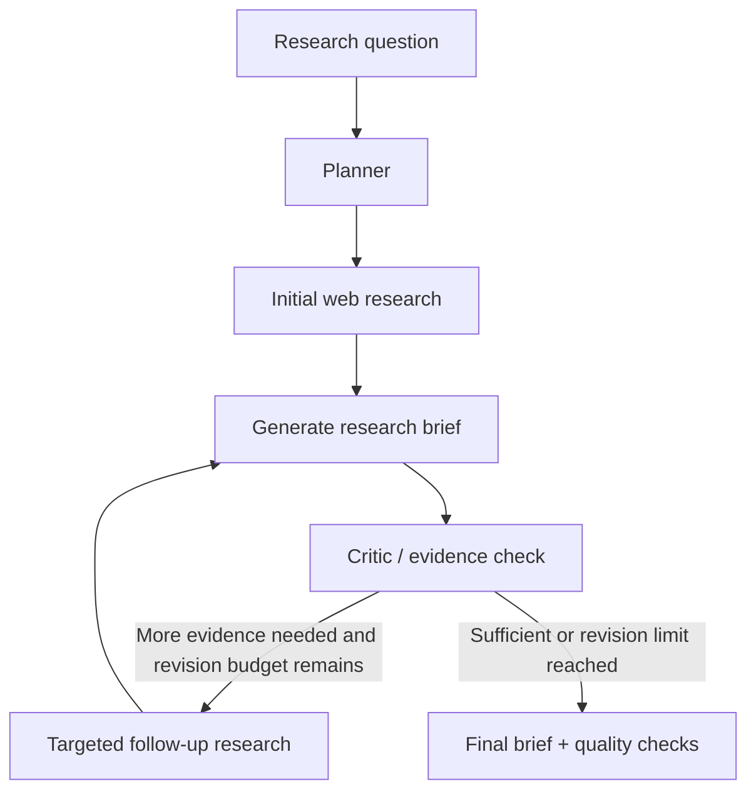

# Agentic AI Research Agent

A research assistant built with **LangGraph**, **LangChain ChatOpenAI**, and **Tavily**. It turns a research question into a plan, searches the web, drafts a source-grounded brief, critiques its own draft, and conditionally gathers more evidence before producing a final report.

> Research prototype: citations and automated checks help with traceability, but they do not guarantee that every claim is supported. Verify important claims against the original sources.

## Features

- **Planning:** decomposes a broad question into research sub-questions.
- **Web research:** generates focused search queries and runs Tavily searches concurrently.
- **Evidence-aware synthesis:** supplies source titles, URLs, snippets, and available publication dates to the writer.
- **Reflection loop:** critiques coverage and evidence, then conditionally triggers follow-up searches.
- **Stateful workflow:** LangGraph `StateGraph` with a SQLite checkpointer and thread IDs.
- **Progress updates:** streams completed node updates using `stream_mode="updates"` (no custom stream writer required).
- **Basic quality checks:** checks citation-marker formatting and whether a Sources section exists; these checks do not verify factual correctness.
- **Markdown export:** saves the final brief to `research_brief.md`.

## Architecture



## Repository structure

```text
agentic-ai-research-agent/
├── notebooks/
│   └── Agentic_AI_Research_Agent.ipynb
├── examples/
│   └── research_tasks.md
├── research_agent.py
├── requirements.txt
├── .env.example
├── .gitignore
├── LICENSE
└── README.md
```

## Requirements

- Python 3.10 or newer
- An OpenAI API key with access to the configured chat model
- A Tavily API key
- Internet access for API calls

## Quick start (local Python)

### 1. Clone the repository

```bash
git clone https://github.com/YOUR-USERNAME/agentic-ai-research-agent.git
cd agentic-ai-research-agent
```

### 2. Create and activate a virtual environment

Windows PowerShell:

```powershell
py -m venv .venv
.venv\Scripts\Activate.ps1
```

macOS / Linux:

```bash
python3 -m venv .venv
source .venv/bin/activate
```

### 3. Install dependencies

```bash
python -m pip install --upgrade pip
pip install -r requirements.txt
```

### 4. Configure API keys

Copy `.env.example` to `.env`, then add your keys:

```env
OPENAI_API_KEY=your_openai_api_key
TAVILY_API_KEY=your_tavily_api_key
OPENAI_MODEL=gpt-4o-mini
```

Never commit `.env` or paste API keys into source code. The `.gitignore` excludes the environment file and local SQLite checkpoint database.

### 5. Run the agent

```bash
python research_agent.py
```

The default task researches recent advances in agentic AI. The final brief is printed to the terminal and exported to `research_brief.md`.

To choose another task, set `RESEARCH_TASK` before running.

Windows PowerShell:

```powershell
$env:RESEARCH_TASK = "Compare RAG and fine-tuning for large language models, including cost, latency, and use cases."
$env:RESEARCH_THREAD_ID = "rag-vs-finetuning"
python research_agent.py
```

macOS / Linux:

```bash
RESEARCH_TASK="Compare RAG and fine-tuning for LLMs, including cost, latency, and use cases." \
RESEARCH_THREAD_ID="rag-vs-finetuning" python research_agent.py
```

Each run can use a distinct thread ID. SQLite stores workflow checkpoints locally; it is not a vector database or semantic memory system. The checkpoint file may contain prompts and drafts, so keep it private.

## Run the notebook

Open `notebooks/Agentic_AI_Research_Agent.ipynb` in Jupyter or upload it to Google Colab. Run the setup cells in order, configure `OPENAI_API_KEY` and `TAVILY_API_KEY` in the notebook environment, and execute the graph demo. If you install packages in a running notebook, restart the kernel if imports remain stale.

The notebook uses ordinary `stream_mode="updates"`. It displays completed node updates, not token-by-token output.

## Example research tasks

See [`examples/research_tasks.md`](examples/research_tasks.md) for additional demos, including RAG vs. fine-tuning, agent evaluation benchmarks, and hallucination mitigation.

## Limitations

- Search results may contain vendor announcements, incomplete snippets, outdated pages, or low-quality sources.
- Source snippets are not substitutes for reading primary papers and original reports.
- Citation-number checks are structural only; they do not prove semantic support for claims.
- Model responses and web results may be inaccurate. Review evidence before using the report for consequential decisions.
- API usage may incur charges.

## Future improvements

- Add domain-aware source ranking and primary-paper preference.
- Fetch and extract full pages or papers when permitted.
- Add retrieval quality metrics and claim-to-source verification.
- Add automated tests and CI for source parsing and graph routing.
- Add an optional Streamlit interface.

## License

MIT. See [LICENSE](LICENSE).
